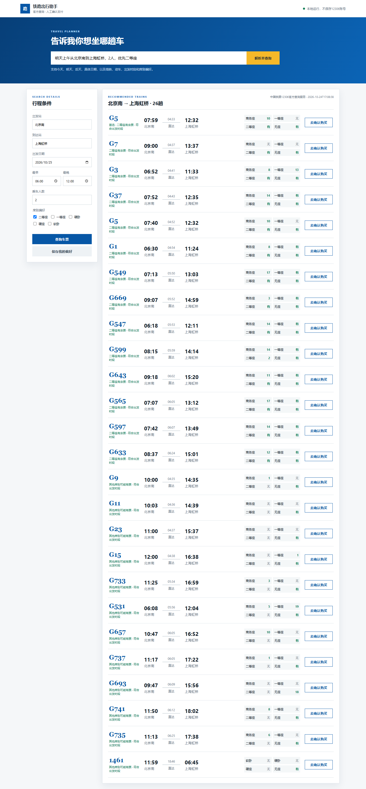

# 铁路低价票查询 Agent

本地运行的铁路出行辅助项目：将自然语言行程解析为结构化查询条件，通过中国铁路12306公开查询服务获取车次，并按余票、价格偏好、时段和行程时间筛选。最终购买仍跳转至12306官方网站，由用户完成登录、乘客确认、订单提交和支付。



## 核心能力

- OpenAI兼容接口将自然语言解析为结构化行程参数，并使用Pydantic校验。
- 模型超时、非法JSON或调用失败时自动回退到规则解析。
- 车次、余票和票价来自查询服务，筛选与排序由Python完成，避免模型编造业务数据。
- 包含请求限速、本地缓存、多条件排序、运行轨迹和自动化测试。

## 安全边界

- 不保存12306账号、密码、身份证、联系人或支付信息。
- 不绕过验证码、候补规则、限流或其他平台控制。
- 不替用户点击订单提交或付款按钮。
- 所有涉及乘客身份、票价和资金的最终操作必须由用户在12306官方页面确认。
- 仅供个人正常购票使用，不用于囤票、倒票或高频自动请求。

## 启动

```powershell
git clone https://github.com/2Ccw/railway-ticket-agent.git
cd railway-ticket-agent
Copy-Item .env.example .env
# 编辑 .env，填入自己的 OpenAI 兼容接口配置
.\start.ps1
```

浏览器打开：<http://127.0.0.1:12306>

## 使用

自然语言示例：

```text
明天上午从北京南到上海虹桥，2人，优先二等座
2026年10月28日下午从广州南到深圳北，二等座
后天晚上从南京南到杭州东，1人
```

系统会自动填充行程条件并查询。选择车次后点击“去确认购买”，阅读并勾选确认提示，随后跳转官方12306页面。请在官方页面重新核对日期、车次、乘客、席别和金额后付款。

也可以手动创建虚拟环境并运行：

```powershell
python -m venv .venv
.\.venv\Scripts\pip install -r requirements.txt
.\.venv\Scripts\python -m uvicorn app.main:app --host 127.0.0.1 --port 12306
```

`.env` 仅保存在本机并已加入 `.gitignore`。仓库中的 `.env.example` 只包含占位值。

## 技术结构

```text
自然语言 → 规则解析 → 车站解析 → 官方余票查询
        → 条件过滤 → 推荐评分 → 官方购买页面
```

- `app/planner.py`：日期、路线、时段、席别和人数解析；车次评分。
- `app/railway.py`：官方车站数据、余票查询、限速、缓存和购票链接。
- `app/main.py`：FastAPI接口和本地偏好保存。
- `web/`：响应式Web操作界面。
- `tests/`：解析、评分和安全边界测试。

## 测试

```powershell
.\.venv\Scripts\python -m pytest -q
```

## 说明

本项目与中国国家铁路集团有限公司及12306无隶属或合作关系。12306接口和预售规则可能调整，查询结果以官方App或网站为准。候补、选座、儿童票、学生票、改签和退票暂不在此MVP内自动处理。
